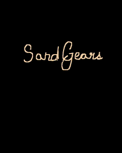

[](https://github.com/jordan-schnur/SandGears/actions/workflows/.rustfmt.yml)
# SandGears
### Inspired By [Powder Toy](https://powdertoy.co.uk/)

SandGears is an interactive 2D sandbox simulation that allows users to experiment with mechanical contraptions and granular materials like sand. Play around with pistons, hinges, heaters, and more to create unique contraptions and observe their effects on the sand environment.


## Getting Started

You need [Rust](https://rustup.rs/) and a GPU driver with Vulkan support (most GPUs from the last decade have one).

```sh
git clone https://github.com/jordan-schnur/SandGears.git
cd SandGears
cargo run --release
```

Shaders are compiled automatically during the build, so the Vulkan SDK is **not** required to play.

- **Linux:** if the game says it can't load Vulkan, install your distro's Vulkan loader and drivers (e.g. `sudo apt install libvulkan1 mesa-vulkan-drivers`).
- **macOS:** install the [Vulkan SDK](https://www.lunarg.com/vulkan-sdk/) to get MoltenVK.
- **Developers:** with the [Vulkan SDK](https://www.lunarg.com/vulkan-sdk/) installed, debug builds (`cargo run`) turn on the validation layers, and their messages show up in the log. [Vulkanalia's tutorial](https://kylemayes.github.io/vulkanalia/development_environment.html) explains the setup.

## Controls

| Input                    | Action                                    |
|--------------------------|-------------------------------------------|
| Left mouse (hold)        | Paint the selected element                |
| Left click on toolbar    | Select an element                         |
| Right mouse (hold)       | Erase                                     |
| `1` `2` `3` `4` `5`      | Sand / Water / Gas / Metal / Eraser       |
| `[` and `]`              | Shrink / grow the brush                   |
| Mouse wheel, pinch       | Zoom in / out at the mouse                |
| Middle drag, two-finger scroll | Pan while zoomed in                 |
| `0`                      | Reset zoom                                |
| `Space`                  | Pause / resume                            |
| `.`                      | Advance one tick while paused             |
| `C`                      | Clear the world                           |
| `Esc`                    | Quit                                      |

The window title shows the selected element, brush size, particle count and FPS.

## Project Layout

```
build.rs            Compiles shaders/*.vert|frag to SPIR-V at build time
shaders/            GLSL: one full-screen triangle that colours each pixel by its world cell
src/
  main.rs           Opens the window and runs the event loop
  game.rs           Controls, brush, pause, fixed 60 Hz simulation ticks
  toolbar.rs        Clickable material buttons drawn above the world
  camera.rs         Zoom and pan
  viewport.rs       Fits the world into the window (shared by drawing and mouse input)
  sim/
    element.rs      Materials and their properties (density, colour, behaviour)
    world.rs        The grid of cells and painting helpers
    physics.rs      Movement rules: powders fall, liquids flow, gases rise
  render/           Vulkan: knows nothing about sand, just draws a grid of colours
    mod.rs          Renderer: per-frame flow, command recording, swapchain rebuilds
    instance.rs     Vulkan instance + validation-layer logging
    device.rs       GPU selection and setup
    swapchain.rs    Window images (rebuilt on resize)
    pipeline.rs     Render pass, shaders, pipeline
    frame.rs        Per-frame command buffer, sync objects and colour buffer
```

**Adding a new material:** add a variant to `Element` in `src/sim/element.rs`, fill in its properties, and give it a key in `src/game.rs`. To give it a new kind of movement, add a `Behavior` and handle it in `src/sim/physics.rs`.

Run the simulation tests with `cargo test`.

## Contributing

Please check the [Issues](https://github.com/jordan-schnur/SandGears/issues) section for more specific tasks and feature requests.

## License

This project is licensed under the MIT License - see the [LICENSE.md](LICENSE.md) file for details.

## TODOs

- [x]  Implement basic sand simulation with a 2D grid.
- [x]  Add more particles...
   - [x] Water
   - [ ] Fire
   - [ ] Lava
   - [x] Gas
   - [ ] Snow
   - [x] Sand
- [x]  Refactor into modules (simulation / game / renderer)
- [ ]  Implement text rendering (the window title is used as a HUD for now)
- [ ]  Add support for mechanical contraptions (pistons, hinges, etc.).
- [ ]  Implement a heater that can melt sand.
- [ ]  Create a user-friendly interface for adding and interacting with contraptions.
- [ ]  Develop a system for saving and loading user-created scenes.
- [ ]  Optimize the simulation for better performance.
- [ ]  Add more types of granular materials with different properties.
- [ ]  Cross-platform builds
- [ ]  Sign builds from [here](https://shop.certum.eu/open-source-code-signing-code.html)
- [ ]  Test on various platforms and fix platform-specific issues.
